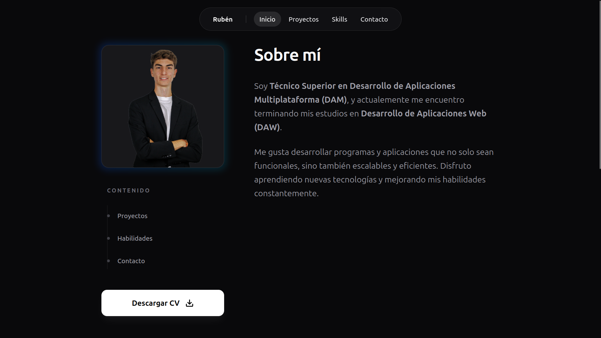

<h1 align="center">Hello , I am Ruben / rabgonzalez</h1> 

<i>Click the image to see portfolio</i>

<h2>🤵 About me</h2>
<ul>
  <li>
    🎓 Technician in Cross-platform application development and web development
  </li>
  <li>
    🏃 I love sports, I have been practising athletics for over the past 10 years.
  </li>
  <li>
    🎵 I enjoy listening to music and hanging out with friends.
  </li>
  <li style="display:none">
    🖥️ Coding = fun (sometimes).
  </li>
</ul>

<h2>💻 Programming languages</h2>

  

<h2>:octocat: Github Stats</h2>

<table align="left">
<tr border="none">
<td width="60%" align="center">

    
   
</td>

<td align="center">

  

  </td>
</tr>
<tr>
  <td align="center" colspan="2">
    
  </td>
</tr>
</table>

---
<h2>🤝 Contact me</h3>

  
  
  

---
<ul>
  <li>Language: 🇪🇸, 󠁧󠁢🇺🇸</li>
</ul>
